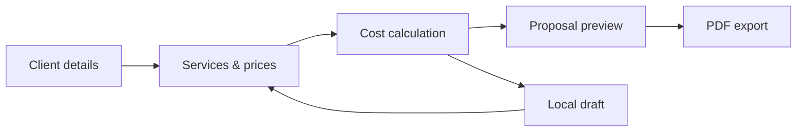

<!-- QuoteCraft • English documentation -->
<p align="right">
  <strong>English</strong> · <a href="./README.ru.md">Русский</a>
</p>

<div align="center">
  <svg xmlns="http://www.w3.org/2000/svg" viewBox="0 0 412 96" role="img" aria-label="QuoteCraft — 03-value-stack">
  <g><path d="M48 11L86 32L48 53L10 32L48 11Z" fill="none" stroke="#FFFFFF" stroke-width="7" stroke-linejoin="round"/>
  <path d="M12 48L48 69L84 48M12 65L48 86L84 65" fill="none" stroke="#FFFFFF" stroke-width="7" stroke-linecap="round" stroke-linejoin="round"/>
  <path d="M37 32H59" stroke="#A5A6FF" stroke-width="6" stroke-linecap="round"/></g>
  <g fill="#FFFFFF"><path d="M146.197265625 67.6328125C148.6494140625 67.6328125 150.943359375 67.2109375 153.0263671875 66.3935546875L156.111328125 70.4013671875H162.7822265625L157.53515625 63.73046875C161.8330078125 60.2236328125 164.49609375 54.5283203125 164.49609375 47.3828125C164.49609375 35.0693359375 156.7177734375 27.080078125 146.197265625 27.080078125C135.6767578125 27.080078125 127.8984375 35.0693359375 127.8984375 47.3828125C127.8984375 59.6171875 135.6767578125 67.6328125 146.197265625 67.6328125ZM143.40234375 53.8955078125 148.8603515625 61.0673828125C148.0166015625 61.2783203125 147.1201171875 61.3837890625 146.197265625 61.3837890625C139.763671875 61.3837890625 134.912109375 56.34765625 134.912109375 47.3828125C134.912109375 38.3916015625 139.763671875 33.3291015625 146.197265625 33.3291015625C152.6044921875 33.3291015625 157.4560546875 38.3916015625 157.4560546875 47.3828125C157.4560546875 52.4453125 155.900390625 56.2685546875 153.3955078125 58.6416015625L149.73046875 53.8955078125Z"/><path d="M178.56171875 67.5537109375C182.411328125 67.5537109375 185.2326171875 65.8662109375 187.1310546875 62.728515625V67.0H193.6701171875V39.15625H186.99921875V54.8974609375C186.99921875 59.6435546875 184.415234375 61.7265625 180.9083984375 61.7265625C177.348828125 61.7265625 175.2921875 59.5908203125 175.2921875 55.50390625V39.15625H168.64765625V56.55859375C168.64765625 63.7041015625 172.7345703125 67.5537109375 178.56171875 67.5537109375Z"/><path d="M211.32167968750002 67.6328125C219.52187500000002 67.6328125 225.05898437500002 61.7529296875 225.05898437500002 53.1044921875C225.05898437500002 44.4560546875 219.52187500000002 38.5234375 211.32167968750002 38.5234375C203.12148437500002 38.5234375 197.58437500000002 44.4560546875 197.58437500000002 53.1044921875C197.58437500000002 61.7529296875 203.12148437500002 67.6328125 211.32167968750002 67.6328125ZM211.32167968750002 62.0693359375C207.02382812500002 62.0693359375 204.30800781250002 58.66796875 204.30800781250002 53.1044921875C204.30800781250002 47.5146484375 207.05019531250002 44.0869140625 211.32167968750002 44.0869140625C215.56679687500002 44.0869140625 218.30898437500002 47.541015625 218.30898437500002 53.1044921875C218.30898437500002 58.6416015625 215.59316406250002 62.0693359375 211.32167968750002 62.0693359375Z"/><path d="M243.63339843750003 39.15625H237.96445312500003V31.5625H231.29355468750003V39.15625H226.44199218750003V44.5087890625H231.29355468750003V59.986328125C231.29355468750003 64.7587890625 233.95664062500003 67.0 239.62558593750003 67.0H243.63339843750003V61.6474609375H240.78574218750003C238.62363281250003 61.6474609375 237.96445312500003 60.98828125 237.96445312500003 59.0107421875V44.5087890625H243.63339843750003Z"/><path d="M259.41289062500005 67.6328125C265.92558593750005 67.6328125 271.09355468750005 63.8623046875 272.14824218750005 58.404296875H265.92558593750005C265.16093750000005 60.77734375 262.91972656250005 62.3857421875 259.57109375000005 62.3857421875C255.08867187500005 62.3857421875 252.50468750000005 59.353515625 252.34648437500005 54.818359375H272.49101562500005V52.9990234375C272.49101562500005 44.4560546875 267.16484375000005 38.5234375 259.14921875000005 38.5234375C251.34453125000005 38.5234375 245.83378906250005 44.640625 245.83378906250005 53.1044921875C245.83378906250005 61.5419921875 251.05449218750005 67.6328125 259.41289062500005 67.6328125ZM252.39921875000005 50.23046875C252.84746093750005 46.2490234375 255.40507812500005 43.796875 259.25468750000005 43.796875C263.10429687500005 43.796875 265.68828125000005 46.2490234375 266.11015625000005 50.23046875Z"/><path d="M293.75488281250006 67.6328125C302.61425781250006 67.6328125 309.36425781250006 62.1484375 310.68261718750006 53.5791015625H303.61621093750006C302.50878906250006 58.5625 298.81738281250006 61.3837890625 293.80761718750006 61.3837890625C286.58300781250006 61.3837890625 282.25878906250006 55.8203125 282.25878906250006 47.3828125C282.25878906250006 38.892578125 286.60937500000006 33.3291015625 293.80761718750006 33.3291015625C298.84375000000006 33.3291015625 302.53515625000006 36.1767578125 303.58984375000006 41.1865234375H310.68261718750006C309.36425781250006 32.5908203125 302.61425781250006 27.080078125 293.75488281250006 27.080078125C282.91796875000006 27.080078125 275.24511718750006 35.04296875 275.24511718750006 47.3828125C275.24511718750006 59.6435546875 282.91796875000006 67.6328125 293.75488281250006 67.6328125Z"/><path d="M314.72871093750007 67.0H321.37324218750007V51.232421875C321.37324218750007 46.8818359375 323.82539062500007 44.693359375 326.98945312500007 44.693359375C328.30781250000007 44.693359375 329.62617187500007 44.8251953125 330.12714843750007 44.904296875V38.998046875C329.59980468750007 38.9453125 328.86152343750007 38.892578125 327.96503906250007 38.892578125C324.37910156250007 38.892578125 322.24335937500007 40.580078125 321.21503906250007 43.7705078125H321.13593750000007V39.15625H314.72871093750007Z"/><path d="M341.7406250000001 67.4482421875C346.2757812500001 67.4482421875 348.6224609375001 65.5498046875 349.9408203125001 63.0712890625H350.0462890625001V67.0H356.5853515625001V48.015625C356.5853515625001 42.21484375 352.2875000000001 38.6025390625 345.0365234375001 38.6025390625C337.7591796875001 38.6025390625 333.2240234375001 42.267578125 332.9076171875001 47.8046875H339.3148437500001C339.4994140625001 45.4580078125 341.6615234375001 43.7705078125 344.9046875000001 43.7705078125C348.0951171875001 43.7705078125 349.9935546875001 45.4580078125 349.9935546875001 47.8310546875V48.0419921875C349.9935546875001 49.9404296875 348.2269531250001 50.01953125 343.0589843750001 50.599609375C337.3109375000001 51.2060546875 332.1166015625001 52.76171875 332.1166015625001 59.08984375C332.1166015625001 64.6533203125 336.2035156250001 67.4482421875 341.7406250000001 67.4482421875ZM343.3753906250001 62.517578125C340.4750000000001 62.517578125 338.6029296875001 61.2255859375 338.6029296875001 59.037109375C338.6029296875001 56.505859375 341.0287109375001 55.4775390625 343.8763671875001 55.0556640625C346.6185546875001 54.6337890625 349.2025390625001 54.2119140625 350.0199218750001 53.6845703125V56.6904296875C350.0199218750001 59.93359375 347.7259765625001 62.517578125 343.3753906250001 62.517578125Z"/><path d="M376.6099609375001 39.15625H370.9410156250001V36.203125C370.9410156250001 33.935546875 371.7847656250001 33.0654296875 374.0523437500001 33.0654296875H376.6099609375001V27.712890625H372.7339843750001C367.2232421875001 27.712890625 364.2701171875001 30.296875 364.2701171875001 35.095703125V39.15625H359.2603515625001V44.5087890625H364.2701171875001V67.0H370.9410156250001V44.5087890625H376.6099609375001Z"/><path d="M394.6042968750001 39.15625H388.9353515625001V31.5625H382.2644531250001V39.15625H377.4128906250001V44.5087890625H382.2644531250001V59.986328125C382.2644531250001 64.7587890625 384.9275390625001 67.0 390.5964843750001 67.0H394.6042968750001V61.6474609375H391.7566406250001C389.5945312500001 61.6474609375 388.9353515625001 60.98828125 388.9353515625001 59.0107421875V44.5087890625H394.6042968750001Z"/></g>
  </svg>

  <p><strong>Smart Proposal & Estimate Builder</strong></p>
  <p>Create estimates. Build proposals. Work smarter.</p>

  <p>
    
    
    
    
    
  </p>

  <p>
    <a href="#overview">Overview</a> ·
    <a href="#planned-features">Features</a> ·
    <a href="#tech-stack">Tech Stack</a> ·
    <a href="#getting-started">Getting Started</a> ·
    <a href="#roadmap">Roadmap</a>
  </p>
</div>

> [!IMPORTANT]
> **Project status: planning / early development.** This document describes the intended product and technical direction. Features, screenshots, a hosted demo, and working commands will be updated as they become available. The banner above is **concept artwork**, not a screenshot of an implemented interface.

## Overview

**QuoteCraft** is a browser-based tool for freelancers and small teams who need to turn a list of services into a clear, client-ready cost estimate or commercial proposal.

Instead of maintaining manual calculations in spreadsheets and formatting each proposal from scratch, the intended workflow is: **add line items → calculate totals → preview → export**.

The initial version is deliberately **frontend-first**, with no account system or backend required. Drafts are planned to be stored locally in the browser.

### Who is it for?

| Audience | Example use case |
| --- | --- |
| Freelancers | Quote a website, design, editing, or consulting project |
| Small agencies | Build consistent proposals for different clients |
| Independent professionals | Calculate services, quantities, and discounts |
| Developers | Explore a framework-free TypeScript application and its testable business logic |

## Product workflow



## Planned features

The checkboxes below are a **development plan**, not a list of shipped capabilities.

| Area | Initial scope | Status |
| --- | --- | --- |
| Proposal editor | Client name, project title, notes, reusable line items | ⬜ Planned |
| Cost calculation | Quantity × unit price, subtotal, discounts, final total | ⬜ Planned |
| Form validation | Required fields, invalid values, helpful error messages | ⬜ Planned |
| Live preview | Document layout that updates as values change | ⬜ Planned |
| Draft persistence | Save and restore drafts in browser storage | ⬜ Planned |
| PDF export | Client-ready document download | ⬜ Planned |
| Responsive UI | Desktop, tablet, and mobile layouts | ⬜ Planned |
| Automated tests | Price calculation and validation coverage | ⬜ Planned |

<details>
<summary><strong>Ideas for later releases</strong></summary>

- Multiple templates and brand customization.
- Proposal duplication and JSON import/export.
- Multi-currency formatting and locale preferences.
- Printable links or cloud synchronization **if a backend is added**.
- Advanced taxes and invoicing rules **only after explicit requirements and tests**.

</details>

### Illustrative cost estimate

This is an **example of expected calculation behavior**, not actual application output.

| Service | Quantity | Unit price | Amount |
| --- | ---: | ---: | ---: |
| UI design | 1 | 5,000 ₽ | 5,000 ₽ |
| Frontend development | 8 | 2,500 ₽ | 20,000 ₽ |
| **Subtotal** | | | **25,000 ₽** |
| Discount (10%) | | | −2,500 ₽ |
| **Final estimate** | | | **22,500 ₽** |

**Calculation rules to implement:**

1. Reject negative quantities and invalid monetary inputs.
2. Define a documented rounding policy and avoid accidental floating-point errors (for example, use integer minor units where appropriate).
3. Apply discounts predictably and keep intermediate values testable.
4. Do **not** claim legal or tax compliance; tax handling is outside the initial scope.

## Tech stack

> [!NOTE]
> The technologies below are **planned**, not proof of an existing implementation.

| Technology | Intended responsibility |
| --- | --- |
| **TypeScript** | Domain models, calculations, and UI logic |
| **Vite** | Local development and production builds |
| **SCSS** | Design tokens, components, and responsive styles |
| **Vitest** | Unit tests for core business rules |
| **Web Storage API** | Local draft persistence (initial MVP) |
| **PDF library — TBD** | Exporting proposal documents |

**Why no frontend framework?** QuoteCraft is intended to demonstrate DOM APIs, component composition, state handling, and separation of concerns using vanilla TypeScript before introducing a framework.

## Proposed architecture

The following is a **target folder layout**. It may evolve during implementation.

```text
QuoteCraft/
├── assets/
│   └── readme/
│       ├── cover.svg
│       └── logo.svg
├── src/                         # Planned application source
│   ├── app/                      # Bootstrapping and orchestration
│   ├── components/               # Reusable UI pieces
│   ├── features/
│   │   ├── proposals/            # Proposal editor and preview
│   │   └── estimates/            # Pricing and discount logic
│   ├── shared/                   # Utilities, types, validation
│   └── styles/                   # SCSS styles and tokens
├── tests/                       # Planned automated tests
├── README.md                    # English
└── README.ru.md                 # Russian
```

### Design principles

- **Business logic separate from DOM rendering:** calculations should be independently testable.
- **Predictable state:** user edits, recalculation, and persistence should follow explicit rules.
- **Accessible interactions:** semantic elements, keyboard navigation, and clear focus states.
- **Responsive by default:** functional proposal editing, not just a scaled desktop layout.
- **Incremental delivery:** a small working MVP before template libraries or cloud features.

## Getting started

The project does not yet include a guaranteed runnable application. **Once the Vite scaffold and `package.json` have been committed**, the expected development workflow will be:

```bash
# Clone the repository (replace OWNER with the GitHub username)
git clone https://github.com/OWNER/QuoteCraft.git
cd QuoteCraft

# After project setup is committed
npm install
npm run dev
```

Planned additional commands (to be documented when scripts exist): `npm run build`, `npm run test`, and `npm run preview`.

> [!WARNING]
> Do not treat these as verified commands until the corresponding scripts exist in `package.json`.

## Quality & acceptance criteria

The MVP will be considered complete when:

- [ ] A user can create, edit, and remove proposal line items.
- [ ] Totals and discounts are correct for tested edge cases.
- [ ] Invalid input produces actionable feedback rather than broken totals.
- [ ] Drafts survive a page refresh on the same browser/device.
- [ ] A readable proposal can be exported to PDF.
- [ ] The full editing flow works with keyboard and on narrow screens.
- [ ] Core calculation logic is covered by automated tests.
- [ ] A public demo, actual screenshots, and confirmed setup instructions are available.

## Roadmap

| Phase | Deliverable | Status |
| --- | --- | --- |
| 01 | Repository setup and domain models | ⬜ Planned |
| 02 | Design system and responsive UI | ⬜ Planned |
| 03 | Proposal editor and line-item controls | ⬜ Planned |
| 04 | Pricing engine and validation | ⬜ Planned |
| 05 | Local drafts and proposal preview | ⬜ Planned |
| 06 | PDF export and print layout | ⬜ Planned |
| 07 | Tests, accessibility review, deployment | ⬜ Planned |

## Privacy and limitations

- **No hosted data storage is planned for the MVP.** Browser storage is device-specific and can be cleared by the user or browser.
- Do not store secrets or highly sensitive client information in local drafts.
- PDF documents will need human review before being sent to clients.
- QuoteCraft is a **proposal/estimate tool**, not an accounting, tax, or legally certified invoicing system.

## Contributing and feedback

This is currently a personal portfolio project. Issues and constructive feedback are welcome once the public repository is available. Please describe the use case, expected result, and reproduction steps when reporting problems.

## License

No open-source license has been selected yet. Until a `LICENSE` file is added, **no permission to reuse or redistribute the source code is granted by default**. See [GitHub's licensing guidance](https://docs.github.com/en/repositories/managing-your-repositorys-settings-and-features/customizing-your-repository/licensing-a-repository).

---

<div align="center">
  <sub>QuoteCraft · From estimates to proposals.</sub><br />
  <sub><a href="./README.ru.md">Читать на русском →</a></sub>
</div>
